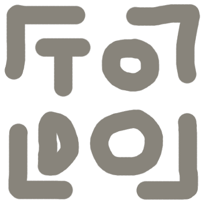

  <!--suppress CheckImageSize, HtmlDeprecatedAttribute -->
  
  <h1>VPKEdit</h1>

  
  
  
  

A utility to create, edit, and display several pack file formats.

  
  

  
  

## Features

- Supported file formats:

  | Format   | Description                                       | Create | Read | Write |
  |----------|---------------------------------------------------|:------:|:----:|:-----:|
  | 007      | Asset pack (007 - Nightfire)                      |   ❌    |  ✅   |   ❌   |
  | APK      | Axiom PacK file (Fairy Tale Busters)              |   ✅    |  ✅   |   ✅   |
  | BEE_PACK| BEE2.4 Package                                    |   ✅    |  ✅   |   ✅   |
  | BMZ      | Bonus Map Zip (Source Engine)                     |   ✅    |  ✅   |   ✅   |
  | BSP      | Source 1 Map                                      |  N/A   |  ✅   |   ✅   |
  | FGP      | File group (PS3, The Orange Box)                  |   ✅    |  ✅   |   ✅   |
  | FPX      | VPK modification (Tactical Intervention)          |   ✅    |  ✅   |   ✅   |
  | GCF      | Game Cache File (Pre-SteamPipe Steam games)       |   ❌    |  ✅   |   ❌   |
  | GMA      | Garry's Mod Addon                                 |   ❌    |  ✅   |   ✅   |
  | GRP      | Group (Build Engine)                     |   ✅    |  ✅   |   ✅   |
  | HOG      | Unknown acronym (Descent)                         |   ❌    |  ✅   |   ❌   |
  | OL       | Worldcraft Object Library                         |   ❌    |  ✅   |   ❌   |
  | ORE      | Unknown acronym (Narbacular Drop)                |   ❌    |  ✅   |   ❌   |
  | PAK      | PAcK file (Quake, original Half-Life, HROT, etc.)|   ✅    |  ✅   |   ✅   |
  | PCK      | Godot PaCK file (Standalone or embedded)          |   ✅    |  ✅   |   ✅   |
  | PK3      | PacK v3 (Quake II)                                |   ✅    |  ✅   |   ✅   |
  | PK4      | PacK v4 (Quake IV, Doom 3)                        |   ✅    |  ✅   |   ✅   |
  | PKZ      | PacK file (Quake II RTX)                          |   ✅    |  ✅   |   ✅   |
  | REZ      | ResourceZ (LithTech Engine)          |   ❌    |  ✅   |   ❌   |
  | SDAT      | Steam Data (PS3 Portal 2, CS:GO)          |   ✅    |  ✅   |   ✅   |
  | SIN      | SiN pack file (SiN 1998)                          |   ❌    |  ✅   |   ✅   |
  | TAB      | Table (Avalanche Engine)                           |   ✅    |  ✅   |   ✅   |
  | VPK      | Valve PacK file (Source Engine)                   |   ✅    |  ✅   |   ✅   |
  | VPK      | Vampire PacK file (V:TMB)                         |   ✅    |  ✅   |   ✅   |
  | VPP      | Volition Pack file (Red Faction, Saints Row)      |   ❌    |  ✅   |   ❌   |
  | WAD      | Where's All the Data (GoldSrc Engine)             |   ✅    |  ✅   |   ✅   |
  | XZP      | Xbox ZiP (Xbox Half-Life 2)                       |   ❌    |  ✅   |   ❌   |
  | ZIP      | ZIP file                                          |   ✅    |  ✅   |   ✅   |

- Preview files contained within the pack file without extracting them:
  - Audio
  - Text files (any encoding)
  - KeyValues files (text files with syntax highlighting)
  - Images
  - Source 1 Textures
    - Prop lightmaps
    - Troika textures
    - Valve textures for both PC and console
  - Source 1 Models
  - Source 1 DMX files (particles, SFM sessions, etc.)
- Create pack files of any version from scratch or an existing folder
- Add and remove files and folders from writable pack files
  - Directly edit text files within writable pack files
- Extract files and folders from readable pack files
- Edit pack file properties such as VPK version
- Native macOS and Linux builds
  - Packaged for Arch, Debian, Fedora, NixOS; standalone builds available

## Credits

- Assets:
  - MatCap texture used in MDL preview is from [nidorx/matcaps](https://github.com/nidorx/matcaps/blob/master/PAGE-15.md#706962_24211e_bcb6af_aca494)
- Dependencies:
  - [argparse](https://github.com/p-ranav/argparse)
  - [discord-rpc](https://github.com/craftablescience/discord-rpc-clean)
  - [SourcePP](https://sourcepp.org)
  - [Qt](https://www.qt.io)
- See the [CREDITS](/CREDITS) file for more information.
